<div align="center">

# 🌿 AgriVision DIP
### Precision Foliar Pathology & Digital Image Processing Benchmark
**An end-to-end framework integrating Classical Digital Image Processing (DIP) with Modern Deep Convolutional Neural Networks across 22 Crop Pathologies.**

[](https://www.python.org/)
[](https://tensorflow.org/)
[](https://keras.io/)
[](LICENSE)
[-success.svg?style=for-the-badge)](#-benchmark-results)
[-blue.svg?style=for-the-badge)](#-benchmark-results)

[🌐 Live Interactive Web Studio](#-interactive-web-application) • [📊 Model Benchmark](#-benchmark-results) • [🧪 DIP Pipeline Lab](#-digital-image-processing-dip-pipeline) • [🌿 22-Class Atlas](#-22-class-foliar-pathology-atlas) • [🚀 Quick Start](#-quick-start)

</div>

---

## 📖 Executive Summary

Agricultural plant pathogens (fungi, bacteria, viruses, and insect pests) cause catastrophic crop yield losses worldwide. Field-level automated diagnosis via computer vision is challenging due to uncontrolled solar illumination, specular highlights, dense canopy clutter, and complex symptom morphology.

**AgriVision DIP** presents a multi-architecture benchmark evaluating **5 Deep Convolutional Networks** on a massive dataset of **25,284 field-acquired foliar images** across **4 major food security crops** (**Cashew, Cassava, Maize, and Tomato**) categorized into **22 distinct classes**. 

The system pairs modern deep transfer learning with an interactive **Light-Themed Web Application & Digital Image Processing Studio**, allowing researchers and agronomists to experiment with spatial filtering, color decomposition, contrast enhancement, and live clinical diagnosis.

---

## 🏆 Key Achievements

- 🥇 **Top Diagnostic Accuracy**: **ResNet50** achieves **87.35% Test Accuracy** ($87.05\%$ F1-Score) across 3,795 unseen test images.
- ⚡ **Ultra-Fast Mobile Edge Inference**: **MobileNetV2** delivers **83.72% Test Accuracy** at **5.41 ms latency** on CPU/GPU — suitable for drone and handheld scouting.
- 🎯 **Best Parameter Efficiency**: **EfficientNetB0** scores **85.77% Test Accuracy** with only **5.3M parameters** via Compound Scaling and Squeeze-and-Excitation (SE) channel attention.
- 🔬 **Interactive DIP Studio**: Real-time browser canvas pipeline demonstrating **Sobel Gradient Magnitude**, **Laplacian 2nd-Derivative Filtering**, **Excess Green Vegetative Index (ExG)**, **Histogram Contrast Stretching**, and **Otsu Binarization**.
- 🖼️ **54 Embedded Notebook Visualizations**: Includes loss/accuracy curves, confusion matrices, and activation maps.

---

## 📊 Benchmark Results

All five architectures were evaluated on the **exact same 3,795 test split images** (stratified 70/15/15 ratio).

| Model Architecture | Accuracy (%) | Precision (%) | Recall (%) | F1-Score (%) | Inference Latency | Parameters | Disk Size | Key Architectural Feature |
| :--- | :---: | :---: | :---: | :---: | :---: | :---: | :---: | :--- |
| **ResNet50** 🏆 | **87.35%** | **87.42%** | **87.35%** | **87.05%** | 26.62 ms | 25.6M | 179 MB | Deep Bottleneck Residual Connections ($F(x) + x$) |
| **EfficientNetB0** ⚡ | **85.77%** | 85.88% | 85.77% | 85.28% | 9.82 ms | 5.3M | 21.1 MB | Compound Scaling ($\alpha \cdot \beta \cdot \gamma$) + SE Channel Attention |
| **MobileNetV2** 📱 | **83.72%** | 83.89% | 83.72% | 83.38% | **5.42 ms** | 3.5M | 25.9 MB | Depthwise Separable Convolutions + Linear Bottlenecks |
| **VGG16** 🏛️ | **77.13%** | 72.40% | 77.13% | 73.61% | 63.81 ms | 138M | 214 MB | Homogeneous Stacked $3\times 3$ Small Kernels |
| **Custom CNN** ⚙️ | **44.35%** | 47.18% | 44.35% | 41.56% | **1.89 ms** | 1.8M | 20.6 MB | 4-Stage Conv2D-BN-ReLU-Pool (Scratch Baseline) |

<div align="center">
  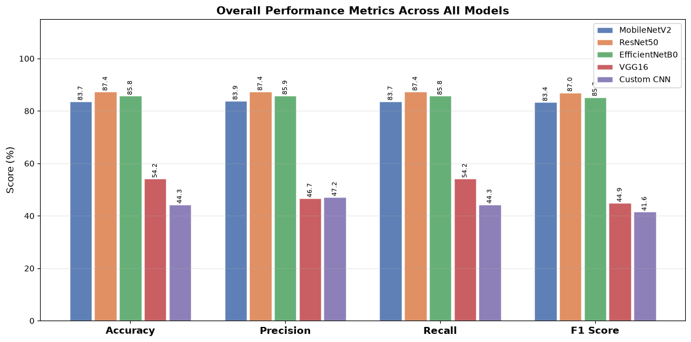
  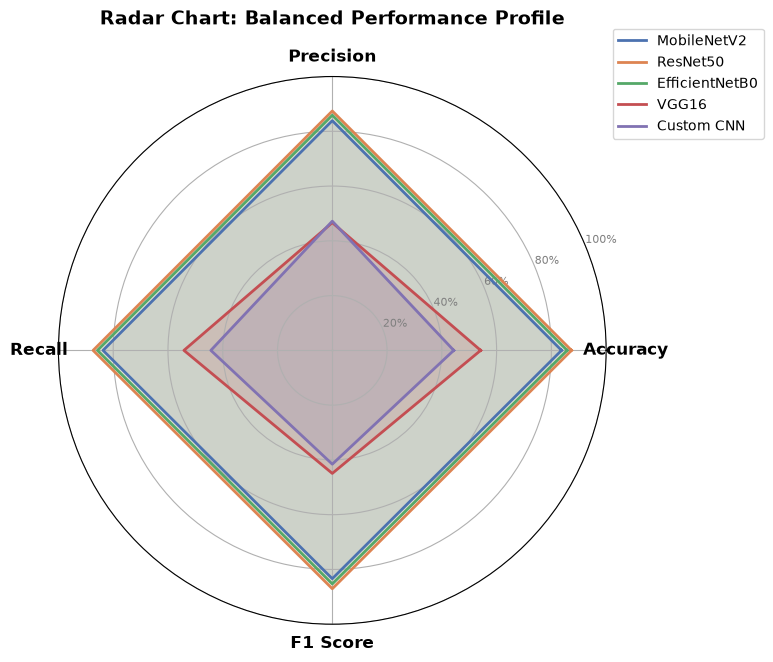
</div>

<div align="center">
  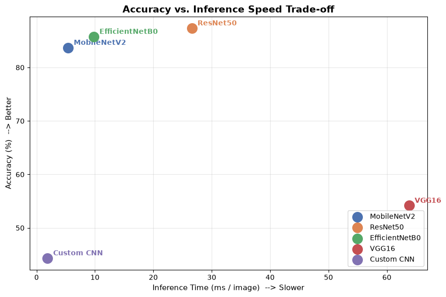
  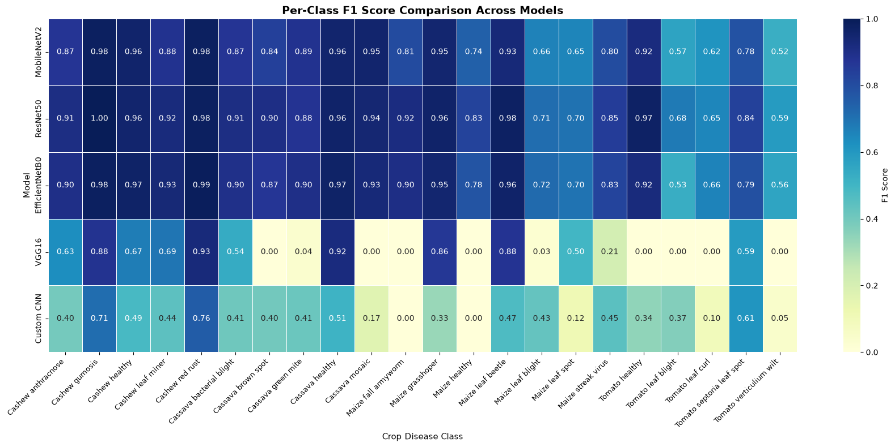
</div>

---

## 🧪 Digital Image Processing (DIP) Pipeline

```
Raw Foliar Image (H x W x 3)
      │
      ▼
Spatial Resizing (224 x 224 x 3 Bilinear Interpolation)
      │
      ├───────────────────────────────┬───────────────────────────────┐
      ▼                               ▼                               ▼
Geometric Augmentations         Radiometric Transforms          Classical DIP Analysis
• Affine Rotation (±90°)        • Contrast Adjustment (±15%)    • Grayscale Luminance (0.299R+0.587G+0.114B)
• Horizontal/Vertical Flips     • Brightness Shift (±10%)       • Sobel Gradient (|Gx| + |Gy|)
• Scale Zoom (±20%)             • Zero-centering / Norm         • Laplacian 2nd Derivative (∇²f)
      │                               │                         • Excess Green Vegetative Index (2G-R-B)
      └───────────────────────────────┼───────────────────────────────┘
                                      ▼
                        Deep Feature Extraction & GAP
                        (ResNet50 / EfficientNet / MobileNet)
                                      ▼
                      Dense Classification (Softmax 22)
```

### 1. Spatial Resizing & Interpolation Theory
Field photographs captured under high resolutions ($> 1024 \times 1024$) are downsampled to canonical dimensions ($224 \times 224 \times 3$) using **Bilinear Interpolation**:
$$f(x', y') \approx (1 - \alpha)(1 - \beta)f(x_1, y_1) + \alpha(1 - \beta)f(x_2, y_1) + (1 - \alpha)\beta f(x_1, y_2) + \alpha\beta f(x_2, y_2)$$
*Trade-off*: Downsampling preserves macro lesion geography while reducing tensor FLOPs by over $20\times$.

### 2. 2D Spatial Convolution Mathematics
Discrete spatial convolution with kernel $K$ of spatial dimensions $M \times N$:
$$Y(i, j) = (X * K)(i, j) = \sum_{m=-M/2}^{M/2} \sum_{n=-N/2}^{N/2} K(m, n) \cdot X(i + m, j + n)$$
While classical DIP relies on fixed mathematical kernels (Sobel for gradient orientation, Gaussian for smoothing), Convolutional Neural Networks **learn adaptive spatial weight matrices $K(m, n)$** via backpropagation.

<div align="center">
  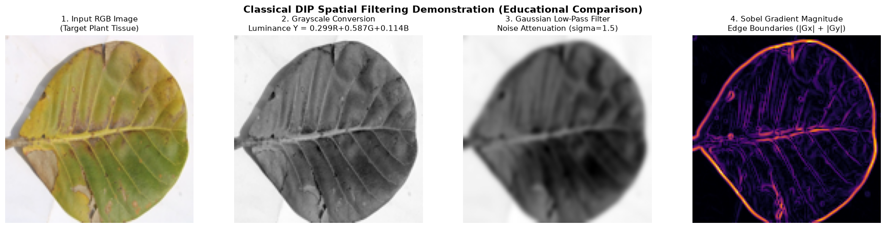
  <p><em>Classical DIP Spatial Filtering Demonstration (RGB, Grayscale, Gaussian Blur, Sobel Magnitude, Laplacian) from CustomCNN.ipynb</em></p>
</div>

### 3. Environmental Quality Degradation Study
Extracted from `Comparison.ipynb`, evaluating resilience against real-world field conditions:
1. **Baseline**: Uncompressed clear field imagery.
2. **Additive Gaussian Noise ($\sigma = 25$)**: Simulates high-ISO camera sensor noise.
3. **Severe Underexposure / Shadow**: Simulates dense canopy occlusions.
4. **Defocus Blur ($\sigma = 3.0$)**: Simulates drone vibration and motion blur.

<div align="center">
  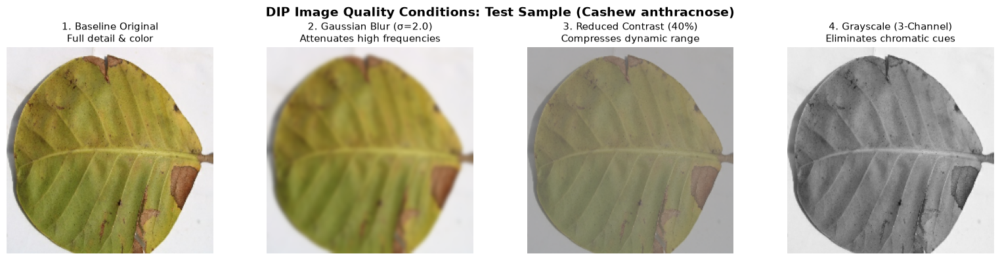
</div>

---

## 🌿 22-Class Foliar Pathology Atlas

The dataset spans 4 economically vital crops across 22 pathological and healthy classes:

<details>
<summary><b>🔍 View Complete Class Taxonomy and Symptom Manifestations (Click to expand)</b></summary>

| Crop | Disease / Class Name | Pathogen / Causative Agent | Diagnostic Visual Manifestation |
| :--- | :--- | :--- | :--- |
| **Cashew** | **Cashew anthracnose** | *Colletotrichum gloeosporioides* (Fungus) | Water-soaked angular reddish-brown necrotic lesions; twig dieback. |
| **Cashew** | **Cashew gumosis** | *Lasiodiplodia theobromae* (Fungus) | Amber gum exudation, bark cracking, rapid leaf chlorosis. |
| **Cashew** | **Cashew healthy** | None (Healthy foliar tissue) | Uniform emerald green hue, intact venation, smooth cuticle. |
| **Cashew** | **Cashew leaf miner** | *Acrocercops syngramma* (Insect Pest) | Serpentine silvery-white winding tunnels across leaf lamina. |
| **Cashew** | **Cashew red rust** | *Cephaleuros virescens* (Alga) | Velvety circular reddish-orange pustules on upper surface. |
| **Cassava**| **Cassava bacterial blight** | *Xanthomonas axonopodis* (Bacterium) | Angular water-soaked spots delimited by veinlets with yellow halo. |
| **Cassava**| **Cassava brown spot** | *Passalora henningsii* (Fungus) | Circular to polygonal brown lesions with distinct dark borders. |
| **Cassava**| **Cassava green mite** | *Mononychellus tanajoa* (Acarid Pest) | Fine chlorotic pinprick stippling; apical leaf distortion. |
| **Cassava**| **Cassava healthy** | None (Healthy foliar tissue) | Well-expanded palmate green lobes, clean petiole attachments. |
| **Cassava**| **Cassava mosaic** | *Cassava mosaic virus* (Geminivirus) | Severe yellow-green mosaic mottle, wrinkled asymmetrical blades. |
| **Maize**  | **Maize fall armyworm** | *Spodoptera frugiperda* (Insect Pest) | Windowpane feeding, ragged perimeter tears, sawdust frass. |
| **Maize**  | **Maize grasshoper** | *Zonocerus variegatus* (Insect Pest) | Extensive leaf chewing; lamina stripped down to central midrib. |
| **Maize**  | **Maize healthy** | None (Healthy foliar tissue) | Upright linear lanceolate leaves, uniform green pigmentation. |
| **Maize**  | **Maize leaf beetle** | *Oulema melanopus* (Insect Pest) | Narrow longitudinal translucent feeding stripes between veins. |
| **Maize**  | **Maize leaf blight** | *Exserohilum turcicum* (Fungus) | Large elliptical cigar-shaped grayish-tan lesions (2-15 cm). |
| **Maize**  | **Maize leaf spot** | *Cercospora zeae-maydis* (Fungus) | Rectangular vein-delimited lesions with sharp parallel margins. |
| **Maize**  | **Maize streak virus** | *Maize streak virus* (Geminivirus) | Broken, narrow chlorotic stripes running parallel along veins. |
| **Tomato** | **Tomato healthy** | None (Healthy foliar tissue) | Serrated deep-green pinnate leaflets, intact trichome hairs. |
| **Tomato** | **Tomato leaf blight** | *Phytophthora infestans* (Oomycete) | Greasy dark water-soaked patches expanding into foliar necrosis. |
| **Tomato** | **Tomato leaf curl** | *Tomato yellow leaf curl virus* | Pronounced upward and inward margin curling, severe stunting. |
| **Tomato** | **Tomato septoria leaf spot** | *Septoria lycopersici* (Fungus) | Tiny circular spots (1-3mm) with ash-gray centers and dark rims. |
| **Tomato** | **Tomato verticulium wilt** | *Verticillium dahliae* (Fungus) | V-shaped chlorotic wedges expanding inward from leaflet tips. |

</details>

---

## 🏛️ Model Architectures & Deep Dives

<details>
<summary><b>1. ResNet50 (87.35% Test Accuracy) — Benchmark Winner</b></summary>

- **Parameters**: 25.6M | **Latency**: 26.6 ms
- **Mechanism**: 50 layers with bottleneck residual blocks ($1\times 1$ compression $\to$ $3\times 3$ conv $\to$ $1\times 1$ expansion) and identity shortcuts ($H(x) = F(x) + x$) eliminating vanishing gradients.
- **Preprocessing**: RGB to BGR transposition + ImageNet channel mean subtraction ($B' = B - 103.939, G' = G - 116.779, R' = R - 123.68$).
- **Training Strategy**: Phase 1 frozen backbone (Adam, LR $10^{-4}$) $\to$ Phase 2 fine-tuning top 20 residual layers (Adam, LR $10^{-5}$).

<div align="center">
  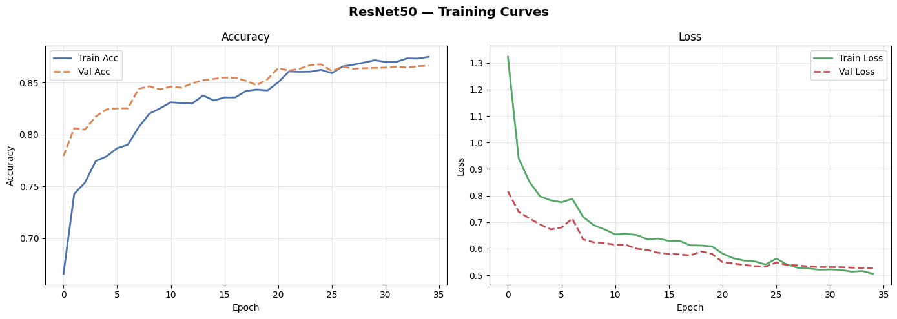
  
</div>
</details>

<details>
<summary><b>2. EfficientNetB0 (85.77% Test Accuracy) — Compact & Attentive</b></summary>

- **Parameters**: 5.3M | **Latency**: 9.8 ms
- **Mechanism**: MBConv inverted bottleneck blocks with **Squeeze-and-Excitation (SE)** attention:
  $$z_c = \frac{1}{HW}\sum_{i=1}^H\sum_{j=1}^W U_c(i, j), \quad \mathbf{s} = \sigma(W_2 \cdot \text{ReLU}(W_1 \cdot \mathbf{z}))$$
  Dynamically amplifies disease-indicative chlorotic channels while suppressing soil clutter.
- **Preprocessing**: Built-in internal Keras normalization layer (inputs kept on raw $[0, 255]$ scale).

<div align="center">
  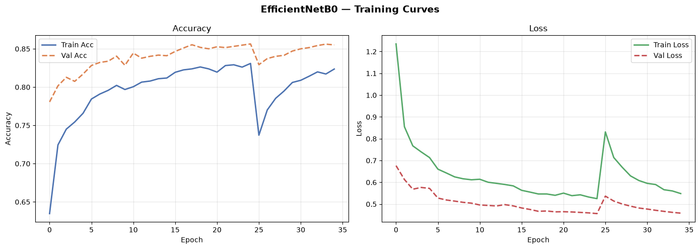
  
</div>
</details>

<details>
<summary><b>3. MobileNetV2 (83.72% Test Accuracy) — 5.4ms Edge Speed</b></summary>

- **Parameters**: 3.5M | **Latency**: 5.41 ms
- **Mechanism**: Factorized Depthwise Separable Convolutions ($3\times 3$ depthwise spatial filter + $1\times 1$ pointwise channel mix) yielding an **$8\times$ to $9\times$ reduction in computational operations**. Inverted residuals with linear bottlenecks prevent manifold collapse.
- **Preprocessing**: Symmetrical normalization to $[-1.0, +1.0]$ via $X' = \frac{X}{127.5} - 1.0$.

<div align="center">
  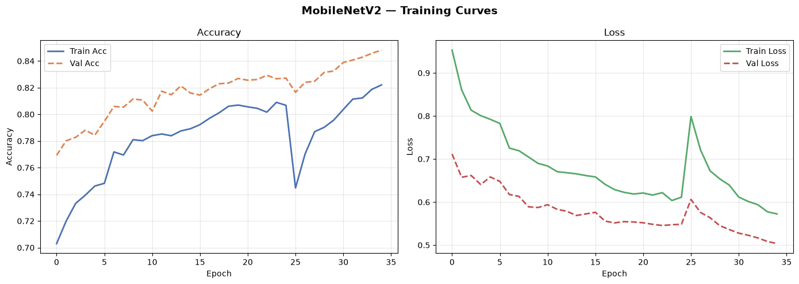
  
</div>
</details>

<details>
<summary><b>4. VGG16 (77.13% Test Accuracy) — Homogeneous Stack</b></summary>

- **Parameters**: 138M | **Latency**: 63.8 ms
- **Mechanism**: Classical deep stack of cascaded $3\times 3$ convolution filters with max-pooling, illustrating receptive field enlargement ($3\times 3 \to 5\times 5 \to 7\times 7$). Unpooled dense flatten head incurs a large parameter footprint.

<div align="center">
  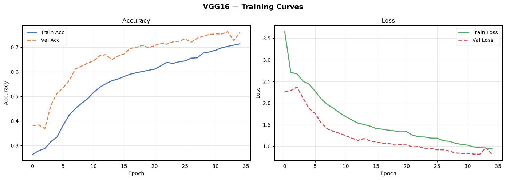
  
</div>
</details>

<details>
<summary><b>5. Custom CNN (44.35% Test Accuracy) — From-Scratch Baseline</b></summary>

- **Parameters**: 1.8M | **Latency**: 1.89 ms
- **Mechanism**: 4-stage convolutional hierarchy (Conv2D $\to$ BatchNorm $\to$ ReLU $\to$ MaxPool) operating at $128 \times 128 \times 3$. Trained from scratch without ImageNet transfer weights, demonstrating the critical importance of pre-trained visual representations in fine-grained plant pathology.

<div align="center">
  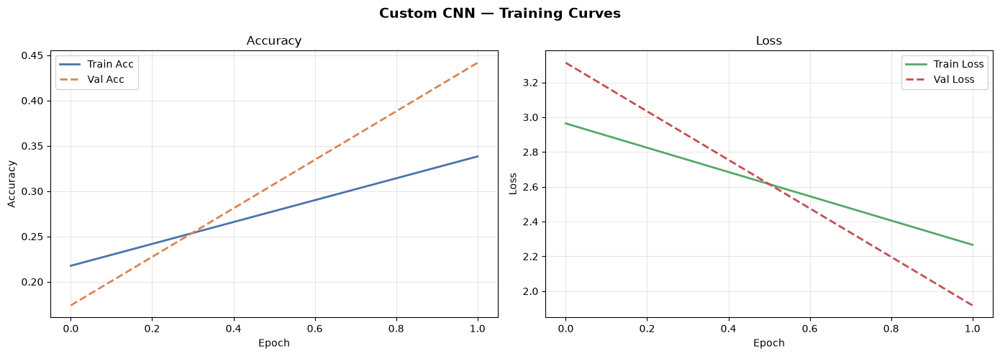
  
</div>
</details>

---

## 🌐 Interactive Web Application

The repository includes a modern, light-themed web platform for clinical decision support:

<div align="center">
  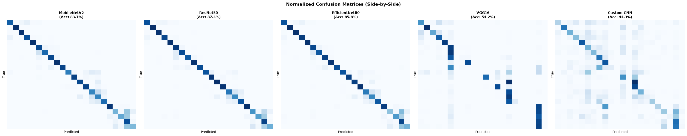
</div>

- **Top Reading Progress Bar**: Real-time reading depth tracker.
- **Floating Capsule Navbar**: Equipped with Scroll Spy, mobile menu drawer, and server status monitor.
- **AI Diagnosis Studio**: Upload or drag-and-drop leaves, or pick from 22 pre-loaded ground-truth samples; displays top-5 confidence bars and multi-model consensus.
- **DIP Canvas Studio**: Real-time HTML5 Canvas applying spatial filters and dynamic RGB histogram computation.
- **Full-Screen Artifact Modal**: Click any visualization to open it in high resolution.

---

## 📂 Repository File Structure

```
DIP_Crop-Disease/
├── .gitignore                      # Clean exclusions (ignores raw 2.5GB dataset & models)
├── README.md                       # Comprehensive project documentation
├── index.html                      # Light-theme interactive web dashboard
├── styles.css                      # Modern CSS design system (glassmorphism, animations)
├── app.js                          # Client-side DIP Canvas processing & UI logic
├── server.py                       # Python HTTP & live model inference API server
├── model_comparison_results.csv    # Official benchmark evaluation metrics
│
├── Comparison.ipynb                # Comparative evaluation, radar charts & degradation study
├── ResNet50.ipynb                  # ResNet50 model pipeline, fine-tuning & evaluation
├── EfficientNet.ipynb              # EfficientNetB0 compound scaling pipeline
├── MobileNet.ipynb                 # MobileNetV2 edge-optimized pipeline
├── VGG16.ipynb                     # VGG16 deep feature extraction pipeline
├── CustomCNN.ipynb                 # From-scratch convolutional network pipeline
│
└── web_assets/                     # 80+ visual artifacts and sample images
    ├── dip_data.js                 # Complete JSON database (metrics, encyclopedia, plots)
    ├── plots_catalog.json          # Index of all 54 notebook-generated plots
    ├── dataset_summary.json        # Class distributions and dataset split counts
    ├── samples/                    # 22 curated test leaf samples for instant testing
    └── *.png                       # High-resolution convergence curves & heatmaps
```

---

## 🚀 Quick Start

### 1. Clone the Repository
```bash
git clone https://github.com/VijaySathappan79/DIP_Crop-Disease.git
cd DIP_Crop-Disease
```

### 2. Install Dependencies
```bash
pip install tensorflow numpy pillow matplotlib seaborn
```

### 3. Launch the Interactive Web Studio & API Server
```bash
python server.py
```
Open your browser and navigate to:
```
http://localhost:8080/
```
*(The web application will run with client-side fallback even if Python is not installed).*

### 4. Run Notebooks
Each notebook is self-contained. Open any notebook in JupyterLab or VS Code:
```bash
jupyter notebook Comparison.ipynb
```

---

## 📜 Citation & Academic Use

If you use this benchmark, web application, or Digital Image Processing pipeline in your research, please cite:

```bibtex
@misc{agrivision_dip_2026,
  author = {Vijay Sathappan},
  title = {AgriVision DIP: Precision Foliar Pathology & Digital Image Processing Benchmark},
  year = {2026},
  publisher = {GitHub},
  howpublished = {\url{https://github.com/VijaySathappan79/DIP_Crop-Disease}}
}
```

---

<div align="center">
  <b>Developed for Precision Agriculture & Computer Vision Research</b><br>
  <sub>Maintained by <a href="https://github.com/VijaySathappan79">VijaySathappan79</a></sub>
</div>
